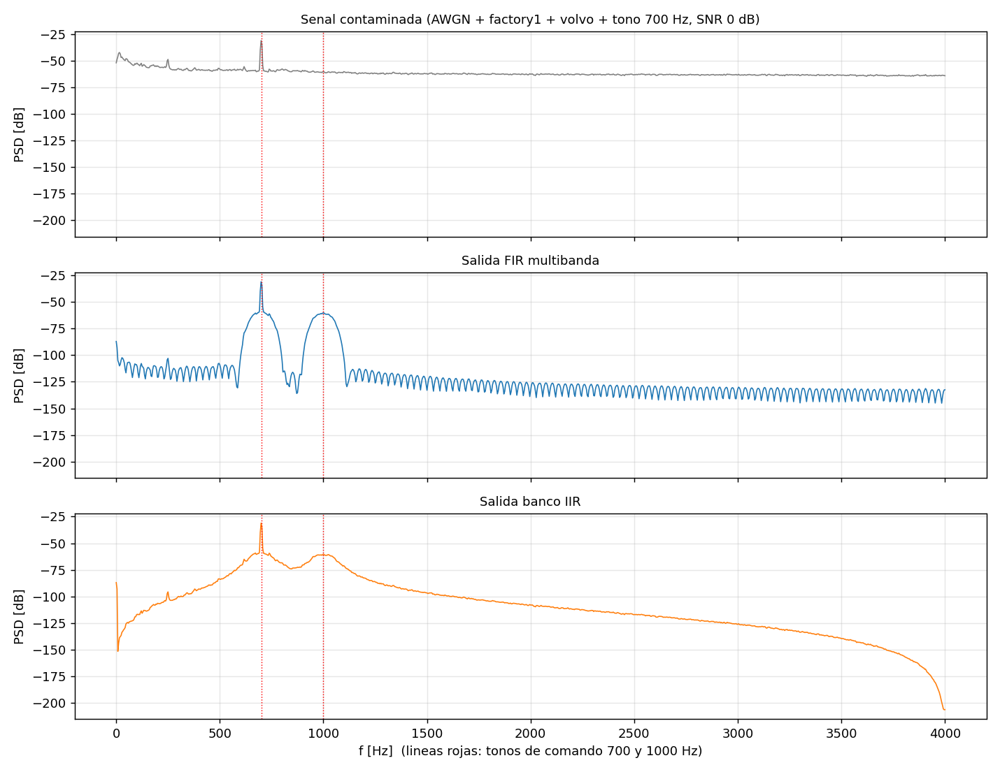
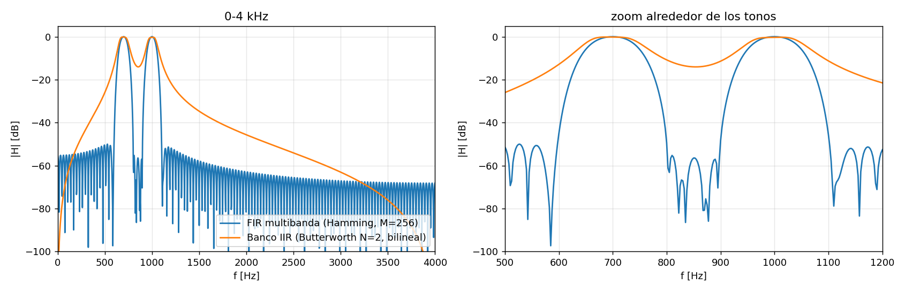
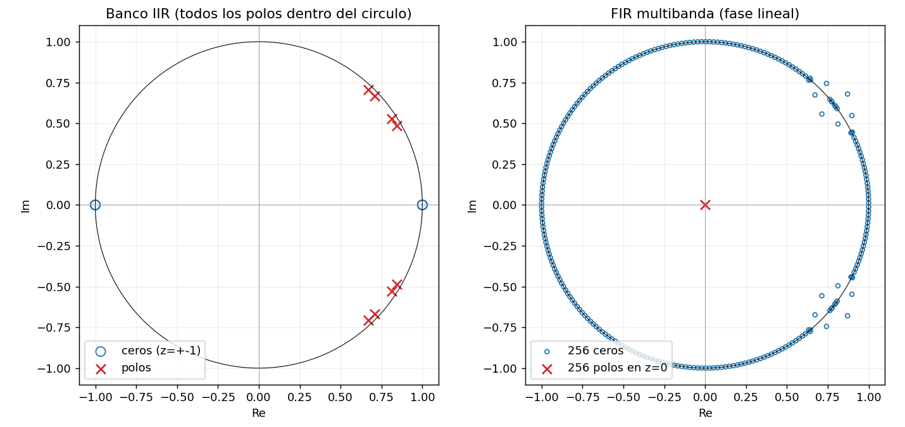
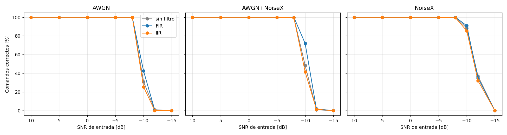

# Memoria de cálculo — Módulo DSP (Entregable 1)

Todos los números salen de `host/out/design_report.txt` y `docs/profile_metrics.txt`, generados por el
código que se compila en la Pico (`make -C host run`). Ningún coeficiente viene de `butter`, `fir1`,
`designfilt` ni `scipy.signal`: el diseño está en `dsp/dsp_design.hpp` y sigue estas ecuaciones.

## 1. Parámetros (REQ-AUD-01, 02)

| | Valor | Justificación |
|---|---|---|
| Fs | 8000 Hz (Ts = 125 µs) | Nyquist 4 kHz ≫ tono más alto (1 kHz) y sus armónicos 2º (2 kHz) y 3º (3 kHz): sin aliasing |
| Tonos | 700 Hz (campo A), 1000 Hz (campo B) | > 100 Hz; separación 300 Hz ≥ 150 Hz |
| Muestreo | reloj ADC 48 MHz ÷ 6000 → DMA a bufer circular | periodo fijado por hardware, no por la CPU |

Se mide `fs` real cada segundo en el firmware (línea `[AUD]`).

## 2. FIR multibanda (REQ-AUD-04)

**Respuesta ideal de una banda** `[ω₁, ω₂]` (rad/muestra) retardada `M/2` (fase lineal), con `m = n − M/2`:

```
h_k[n] = ( sin(ω₂ m) − sin(ω₁ m) ) / (π m)      m ≠ 0
h_k[M/2] = (ω₂ − ω₁) / π
```

Cada tono `F_k` abre una ventana estrecha `ω₁,₂ = 2π(F_k ∓ 50)/Fs`. Superposición de las bandas y ventana
de Hamming `w[n] = 0.54 − 0.46 cos(2πn/M)`:

```
h[n] = Σ_k  h_k[n] w[n] / G_k          G_k = |Σ_n h_k[n] w[n] e^{-jω_k n}|
```

`G_k` ≈ 0.991 (para ambas bandas): el enventanado baja un poco la ganancia en el centro, y se normaliza
para que cada tono pase con ganancia 1. Los 257 coeficientes están en `dsp/dsp_coeffs.h` (`dsp_fir_h`);
son simétricos, por lo que la fase es exactamente lineal.

**Elección del orden M = 256.** El ancho de transición de Hamming es `Δf ≈ 3.3·Fs/M` (∝ Fs/M).
Con bandas de ±50 Hz y tonos separados al menos 150 Hz, la transición de cada borde debe caber en la
brecha: `Δf ≤ 2(150 − 50) = 200 Hz` ⇒ `M ≥ 3.3·8000/200 = 132`. Se toma **M = 256** (Δf = 103 Hz) para
tener margen y mucho rechazo entre tonos. **Retardo de grupo** `τ = M/(2Fs) = 128 muestras = 16 ms`,
irrelevante frente a la decisión de 200 ms.

Costo: 257 MAC/muestra en forma directa I con bufer circular (se podrían reducir a ~129 explotando la
simetría; no se hizo para mantener la forma directa que pide el reto).

## 3. Banco IIR (REQ-AUD-05)

Por cada tono, un pasabanda Butterworth de orden 4 (2 biquads en cascada) y los tonos en paralelo
(las salidas se suman).

**a) Prototipo y transformación a pasabanda.** Butterworth analógico pasabajas `Ω_c = 1 rad/s`, orden N = 2:

```
p_i = exp( jπ(2i + N − 1)/(2N) ),  i = 1..N   →   p = −0.7071 ± 0.7071j
```

Bordes de −3 dB `F_k ± 50 Hz` con **prewarping** `Ω = (2/Ts) tan(ω/2)`:

```
Ω₀² = Ω₁ Ω₂ ,   B = Ω₂ − Ω₁ ,   s → (s² + Ω₀²)/(B s)
```

| Tono | Ω₁ [rad/s] | Ω₂ [rad/s] | B | **Ω₀,k = √(Ω₁Ω₂)** | centro digital real |
|---|---|---|---|---|---|
| 700 Hz | 4175.144 | 4853.547 | 678.403 | **4501.584** | 698.4 Hz |
| 1000 Hz | 6262.279 | 6998.544 | 736.264 | **6620.184** | 999.0 Hz |

Cada polo `p` da dos polos del pasabanda: raíces de `s² − pBs + Ω₀² = 0`. El pasabanda tiene N ceros en
`s = 0` y N en `s = ∞`.

**b) Discretización: bilineal con prewarping.** `s = (2/Ts)(1 − z⁻¹)/(1 + z⁻¹)`, es decir
`z = (1 + sTs/2)/(1 − sTs/2)`. `s = 0 → z = 1` y `s = ∞ → z = −1`, así que cada biquad queda

```
H(z) = g (1 − z⁻²) / (1 + a₁ z⁻¹ + a₂ z⁻²)
```

La ganancia `g` se ajusta para `|H(e^{jω_k})| = 1` en el tono. Coeficientes obtenidos:

| Tono | Biquad | b₀ = −b₂ | b₁ | a₁ | a₂ | polo z |
|---|---|---|---|---|---|---|
| 700 Hz | 0 | 0.03821410 | 0 | −1.68953816 | 0.94837077 | 0.8448 ∓ 0.4845j (\|z\|=0.9738) |
| 700 Hz | 1 | 0.03821410 | 0 | −1.62896609 | 0.94359124 | 0.8145 ± 0.5293j (0.9714) |
| 1000 Hz | 0 | 0.03821409 | 0 | −1.41530480 | 0.94744168 | 0.7077 ∓ 0.6683j (0.9734) |
| 1000 Hz | 1 | 0.03821409 | 0 | −1.33677862 | 0.94451654 | 0.6684 ± 0.7055j (0.9719) |

**c) Por qué bilineal y no invarianza al impulso.** La invarianza al impulso `z = e^{sTs}` solo mantiene
la respuesta si `H_a` está limitada en banda; un pasabanda Butterworth no lo está (decae como 1/Ω), así
que sus colas se pliegan sobre la banda de interés (**aliasing**) y la ganancia/cero en Nyquist no se
controla. La bilineal mapea todo el eje Ω a un solo círculo (sin aliasing, ceros en `z = ±1` exactos); su
costo es la compresión no lineal de frecuencias, `ω = 2 atan(ΩTs/2)`, que se compensa con el prewarping
(centro digital a 1.6 Hz de 700 Hz y 1.0 Hz de 1000 Hz; en el tono la ganancia es 1 por la normalización).
La fase no es lineal (a diferencia del FIR), pero a Goertzel solo le importa la magnitud.

**Estabilidad:** radio máximo de polos 0.9738 (700 Hz) y 0.9734 (1000 Hz) < 1 ⇒ **estable**, comprobado
por el generador (`gen_coeffs` termina con error si algún `|p_i| ≥ 1`). El diagrama de polos y ceros
está en la figura 2.

## 4. Detección y validación (REQ-AUD-07, 08, 10)

* **Goertzel** por bloque de N = 400 muestras (50 ms) con ventana Hann; los tonos caen exactamente en los bins
  35 y 50. Amplitud `A = 4|X|/N`.
* **Magnitud:** umbral por tono calibrado con 2 s de ruido ambiente: `thr = max(0.01, μ + 6σ)`.
* **Ambigüedad:** se rechaza el bloque si el segundo tono llega a ≥ 50 % del mayor.
* **SNR:** `SNR = P_tono / (P_total − P_tono)` con `P_tono = A²/2`; se rechaza si cae bajo −10 dB.
* **Duración:** 4 bloques consecutivos (200 ms) del mismo tono; luego 1.5 s de reposo.
* **Acción (REQ-AUD-10):** solo tras pasar lo anterior se manda `0x102` por CAN.

## 5. Resultados medidos (PC, mismo código que la Pico)

### Perfilado espectral (Entregable 2) — tono 700 Hz, SNR de entrada 0 dB, AWGN + `factory1` + `volvo`





| Métrica | FIR | IIR |
|---|---|---|
| Ganancia de SNR (banda ancha) | **+14.8 dB** | **+13.1 dB** |
| Ganancia del tono en banda de paso | +0.01 dB | −0.17 dB |
| Atenuación del ruido 100–600 Hz | 55.9 dB | 26.9 dB |
| Atenuación del ruido **entre tonos** (800–900 Hz) | **56.5 dB** | **12.8 dB** |
| Atenuación 1150–3900 Hz | 63.2 dB | 32.6 dB |
| Máx. componente fuera de banda (≥100 Hz de ambos tonos) | −71.5 dB re tono | −37.4 dB re tono |
| Armónicos del tono (2f / 3f) | −140 / −141 dBc | −134 / −126 dBc |

(La banda del otro tono de comando se excluye del fuera-de-banda: pasa por diseño.) El IIR de orden 4 deja
solo ~13 dB entre tonos; subir `DSP_IIR_LP_ORDER` a 3 o 4 lo mejora a costa de más biquads.

### Curva de estrés (Entregable 3) — 200 pruebas por punto, tono de 1 s, ruido RMS fijo



Aciertos [%] (el campo equivocado fue 0 % en todos los puntos). Tabla completa en `docs/bench_log.txt` / `stress.csv`.

| SNR de entrada | AWGN: sin filtro / FIR / IIR | AWGN+NoiseX: sin filtro / FIR / IIR | NoiseX: sin filtro / FIR / IIR |
|---|---|---|---|
| +10 … −5 dB | 100 / 100 / 100 | 100 / 100 / 100 | 100 / 100 / 100 |
| −8 dB | 100 / 100 / 100 | 99.5 / 100 / 99.5 | 100 / 100 / 99.5 |
| −10 dB (borde, ver nota) | 31 / 42.5 / 25.5 | 48.5 / 72 / 41.5 | 88.5 / 91 / 85.5 |
| −12 dB | 1 / 0.5 / 0 | 1 / 2 / 1.5 | 37 / 35 / 32 |
| −15 dB | 0 / 0 / 0 | 0 / 0 / 0 | 0 / 0 / 0 |

Falsas alarmas con solo ruido: 0 en 132 s por escenario y cadena; dos tonos de igual amplitud: **0 de 200 aceptados**
en las tres cadenas (el rechazo por ambigüedad funciona).

**Lectura honesta:** hasta −8 dB las tres cadenas aciertan 100 % y a −15 dB ninguna acierta, en C y en MATLAB.
Entre −10 y −12 dB (el borde) los porcentajes **no son consistentes entre implementaciones ni semillas**: en C el FIR
sale mejor (72 % vs 48.5 % sin filtro en AWGN+NoiseX), en MATLAB (`matlab/stress_test.m`, 100 pruebas) sale peor
o igual (81 % vs 87 %). La causa es que el umbral se calibra una sola vez con 40 bloques de ruido por escenario, y en el
borde un umbral algo alto o bajo mueve el resultado decenas de puntos. **No se puede concluir que un filtro detecte
mejor que otro**; el límite lo pone la compuerta de validación (umbral calibrado y margen de SNR de −10 dB), no el filtro:
un Goertzel de 50 ms con Hann ya es muy selectivo (resolución ≈ 30 Hz) por sí solo. La utilidad real de los filtros está
en los espectros (limpian el espacio entre tonos y suben la SNR de salida 13–15 dB), que importa si luego se detecta con
umbral directo o con ruido de banda angosta cerca de un tono. Para comparar detectores en el borde habría que repetir la
calibración en cada prueba o usar muchas más pruebas. Hay 132 s de ruido por escenario: sirve para decir
"0 falsas alarmas observadas", no para garantizar una tasa por hora.

### Benchmark (Entregable 4)

Referencia en la PC (x86 -O2, instrumentado con contador de MAC) y **pendiente de medir en la Pico**
(`b` en el monitor serial; llenar la columna):

| Bloque | MAC/muestra | RAM de estado | PC [ns/muestra] | **Pico 2 W [µs/muestra] / CPU %** |
|---|---|---|---|---|
| Bloqueo DC | 1 | 8 B | 4.0 | _medir_ |
| FIR multibanda M=256 | 257 | 1032 B | 203 | _medir_ |
| Banco IIR (2 tonos × 2 biquads) | 20 | 32 B | 6.1 | _medir_ |
| Tubería completa (DC + FIR + IIR + 3×Goertzel) | 287 | 1176 B | 221 | _medir_ |

Flash: coeficientes FIR 1028 B, IIR 80 B; RAM de la ventana Hann 1600 B. Presupuesto de tiempo real a 8 kHz:
125 µs por muestra. El FIR cuesta ~13× más MAC que el IIR para ~44 dB más de rechazo entre tonos (56.5 vs 12.8 dB).

## 6. Limitaciones conocidas

* No se probó el micrófono real ni el firmware en la placa (sí compila sin avisos); el pin GP29 es dudoso (ver README).
* El banco de pruebas supone ruido ambiente de nivel fijo y ADC ideal de 12 bits (cuantiza y recorta, sin ruido analógico del MAX4466 ni respuesta del altavoz).
* La compuerta de SNR usa la potencia total del bloque, así que se sesga con ruido de muy baja frecuencia dominante.
